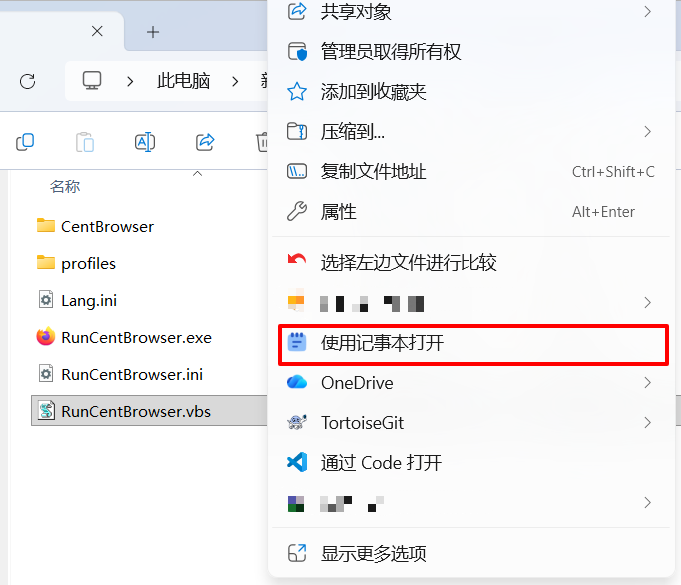

# NotepadReplacer

[English](README.md) | [简体中文](README.zh-CN.md)

[](https://nightly.link/benzBrake/NotepadReplacer/workflows/nightly/master/NotepadReplacer-nightly)


NotepadReplacer is a Windows Notepad replacement tool. It forwards calls to `notepad.exe` to a text editor selected by the user and adds an “Open with Notepad” context-menu command to File Explorer on Windows 11.

The installer handles target-program selection, removal of the Microsoft Store version of Notepad, system configuration, context-menu deployment, and uninstall cleanup. `NotepadReplacerLauncher` is the lightweight component that forwards process calls; it is not the name of the project itself.



## Features

- Forward calls to `notepad.exe` to a specified `.exe` program.
- Deploy the Launcher for the system architecture; on 64-bit systems, configure both 32-bit and 64-bit IFEO registry views.
- Register a Shell `notepad` entry through App Paths, including systems without a System32 Notepad executable.
- Escape and forward valid arguments according to Windows command-line rules, including spaces, quotes, and backslashes.
- Add an “Open with Notepad” command to the top-level File Explorer context menu on 64-bit Windows 11.
- Open multiple selected files from the context menu in one operation.
- Provide Chinese and English installer interfaces, with rollback on installation failure and cleanup during uninstall.

## Installation and Usage

1. Run `NotepadReplacerSetup.exe` as an administrator.
2. Select the executable file that should replace Windows Notepad, such as the `.exe` file of another text editor.
3. Confirm removal of the Microsoft Store version of Notepad and wait for installation to finish.
4. Files opened through `notepad.exe` will then be forwarded to the selected program. On supported Windows 11 systems, you can also use “Open with Notepad” from the File Explorer context menu.

The installation directory is fixed at `Program Files\NotepadReplacer` on the system drive. The target program path is stored at:

```text
HKEY_LOCAL_MACHINE\SOFTWARE\NotepadReplacer\TargetPath
```

`Win+R` commands such as `notepad` and `notepad "C:\folder with spaces\file.txt"` use the Shell entry. Launching the Launcher without arguments also opens the configured editor.

### Before You Install

- The installer requires administrator privileges.
- Installation removes the Microsoft Store version of Notepad installed for the current user and removes its corresponding provisioned package from the system.
- Uninstalling NotepadReplacer **does not automatically restore the Microsoft Store version of Notepad**. Reinstall it manually from the Microsoft Store if needed.
- The selected replacement program must remain at its original path. Forwarding and the context menu will not work correctly if the file is moved or deleted.
- If an IFEO Debugger configuration for `notepad.exe` already exists and does not belong to this project, installation stops to avoid overwriting it.
- The complete x64 installation requires 64-bit Windows 11 (Build 22000 or later). Installation rolls back if the context-menu package cannot be registered.
- Installation replaces only the default value of the machine-wide App Paths entry, preserving its other values and subkeys. The original default value and type are saved under `HKLM\SOFTWARE\NotepadReplacer\AppPathsBackup` and retained across upgrades. Uninstall restores that value only if the entry still points to this project's Launcher; later changes by users or other software are preserved. HKCU App Paths entries are not modified and may affect Shell resolution.

## How It Works

NotepadReplacer consists of the installation/configuration flow, a process-forwarding component, and Windows 11 context-menu components:

| Component | Responsibility |
| --- | --- |
| `NotepadReplacerSetup.exe` | Selects the target program, removes Store Notepad, deploys files, writes IFEO and the target path, and handles rollback and uninstall |
| `NotepadReplacerLauncher` | Receives IFEO Debugger arguments, removes the `notepad.exe` path added by Windows, then forwards the remaining arguments to the target program |
| `NotepadReplacerContextMenu.dll` | Implements the Windows 11 File Explorer command and passes selected files to the configured target program |
| `NotepadReplacer.msix` | Registers the context-menu command and COM component through the `windows.fileExplorerContextMenus` extension; it is a hidden sparse package whose DLL is loaded from the normal install directory |

The installer writes the architecture-specific Launcher to the following IFEO configuration:

```text
HKLM\SOFTWARE\Microsoft\Windows NT\CurrentVersion\Image File Execution Options\notepad.exe
```

The call flow is:

```text
An application or command line calls notepad.exe
  -> Windows starts NotepadReplacerLauncher through IFEO
  -> The Launcher removes the extra IFEO arguments
  -> The Launcher creates the selected target process and exits immediately
```

The context menu does not go through `notepad.exe`. It reads the target path saved by the installer, starts the target program directly, and passes all selected files to it.

The installer also registers `HKLM\SOFTWARE\Microsoft\Windows\CurrentVersion\App Paths\notepad.exe` with the Launcher path. Shell launches resolve this entry, and the Launcher reads `TargetPath` before forwarding any document arguments. App Paths is shared between 32-bit and 64-bit processes on supported Windows versions.

`CreateProcess` does not search App Paths. Calls that hardcode a missing `C:\Windows\System32\notepad.exe` remain unsupported; the installer does not create placeholder executables or write into Windows system directories. Start menu search is a separate entry point and is not guaranteed by App Paths registration.

## Building from Source

### Build the Installer with WSLC

With WSLC installed and enabled on Windows, run the following. No local Visual Studio, Windows SDK, or Inno Setup installation is required:

```powershell
powershell -ExecutionPolicy Bypass -File .\build-wslc.ps1
```

The script installs CMake, Ninja, and MinGW-w64 inside a Debian Linux container and cross-compiles the x64/x86 Launchers, x64 context-menu DLL, and tests for both architectures. No compiler dependencies are installed in Windows or your regular WSL distribution. The first build downloads the base image and packages; subsequent builds use the WSLC build cache. Images and caches still consume local disk space.

The script validates the installer source, builds components in a container, runs both Windows test executables on the host, then packages the MSIX with Microsoft's open-source MSIX SDK, signs with osslsigncode, and compiles the installer with Inno Setup 6 under Wine inside a container. The result is `dist\NotepadReplacerSetup.exe`; the MSIX and public certificate are in `dist\context-menu-package`. Preparing the packaging image downloads and builds tools, including 32/64-bit Wine, so the first run takes more time and disk space than compiling components alone. Later runs reuse images and build caches.

If neither a local certificate nor an environment certificate is configured, the script automatically runs `installer/New-SigningCertificate.ps1` using built-in Windows PowerShell to create a persistent local self-signed certificate. Subsequent runs reuse it without overwriting signing material. An existing local PFX takes precedence over `WINDOWS_CERTIFICATE` and `WINDOWS_CERTIFICATE_PASSWORD`. Private keys and passwords are mounted read-only only while the packaging container runs and are never included in image layers. The packaging container has networking disabled; temporary signing files are removed after it exits. Building does not add certificates to the host's trusted certificate stores.

Component outputs go to `dist\wslc\x64\Release` and `dist\wslc\x86\Release`, separately from MSVC builds. Options include `-Configuration Debug`, `-OutputDirectory <components directory>`, `-InstallerOutputDirectory <installer directory>`, `-SkipTests`, and `-SkipInstaller`. Compiler runtimes are linked statically, so no MinGW runtime DLLs need to be distributed. Image build contexts include only component sources, resources, and container build scripts, and exclude `.certificates`.

To compile components only, skipping the packaging image and certificate preparation, run:

```powershell
powershell -ExecutionPolicy Bypass -File .\build-wslc.ps1 -SkipInstaller
```

The existing GitHub Actions Nightly workflow can also generate the complete installer. Container build validation includes core unit tests, MSIX digest and signature checks, and Inno Setup compilation. Explorer registration and installation/uninstallation still need testing in a Windows 11 test environment.

### Local MSVC Requirements

- Visual Studio 2022 with the “Desktop development with C++” workload
- CMake 3.21 or later
- Windows 10/11 SDK
- Inno Setup 6 (only required to build the installer)

### Build the Program Components

Run the build script to generate the x64 Launcher, x64 context-menu DLL, and x86 Launcher required by the installer:

```powershell
powershell -ExecutionPolicy Bypass -File .\build.ps1
```

The script builds the Release configuration and uses the static MSVC runtime by default. Use `-Configuration Debug` for another configuration, or `-DynamicRuntime` to use the dynamic runtime (the target system must have the corresponding Visual C++ Runtime installed).

All build outputs are written to `dist`: the x64 and x86 CMake build directories are `dist\x64` and `dist\x86`, respectively, and the context-menu package is located at `dist\context-menu-package`.

To build only the Launcher, disable the Windows 11 context-menu component:

```powershell
cmake -S . -B dist/x64 -G "Visual Studio 17 2022" -A x64 -DNOTEPADREPLACER_BUILD_CONTEXT_MENU=OFF
```

Run the tests:

```powershell
cmake --build dist/x64 --config Release --target launcher_core_tests launcher_test_entry launcher_test_editor
ctest --test-dir dist/x64 -C Release --output-on-failure
cmake --build dist/x86 --config Release --target launcher_core_tests launcher_test_entry launcher_test_editor
ctest --test-dir dist/x86 -C Release --output-on-failure
```

See [issue #1 validation](docs/issue-1-validation.md) for automated coverage and the disposable Windows acceptance checklist.

### Build the Installer

After completing the x64 and x86 Release builds, run:

```powershell
powershell -ExecutionPolicy Bypass -File installer/build-installer.ps1
```

The script performs the following steps:

1. Checks for the x86 and x64 Launchers and the x64 context-menu DLL.
2. Uses the Windows SDK `MakeAppx.exe` to create the MSIX package.
3. Signs the MSIX with `SignTool.exe` and exports the certificate required during installation.
4. Calls Inno Setup's `ISCC.exe` to generate the final installer.

The output file is:

```text
dist\NotepadReplacerSetup.exe
```

Before building the installer for the first time, generate a fixed self-signed certificate locally:

```powershell
powershell -ExecutionPolicy Bypass -File installer/New-SigningCertificate.ps1
```

The generated PFX, password, and Base64 files are placed in `.certificates`, which is ignored by Git. `build-installer.ps1` prefers the local `NotepadReplacer.pfx` and `NotepadReplacer.password`; if they are unavailable, it uses the `WINDOWS_CERTIFICATE` (Base64 PFX) and `WINDOWS_CERTIFICATE_PASSWORD` environment variables.

For GitHub Actions, save the contents of `.certificates/NotepadReplacer.pfx.base64` as the repository secret `WINDOWS_CERTIFICATE`, and the contents of `.certificates/NotepadReplacer.password` as `WINDOWS_CERTIFICATE_PASSWORD`. Local and remote builds will then use the same certificate.

When installing the context menu, the installer adds the MSIX signing certificate to the local `TrustedPeople` certificate store and registers the package with the installation directory as its external location. The package uses `AppListEntry="none"`, so it is not intended to appear as a second actionable app in Installed apps; uninstall removes the package, external-location files, and certificate.

## Troubleshooting

The Launcher also supports file associations: when passed a document path directly, it reads the configured editor and forwards the document arguments. Existing IFEO calls continue to use the editor supplied on the command line. A first argument ending in `.exe` is treated as an editor executable, so opening `.exe` files as documents through this interface is not supported.

If registration of the Windows 11 context menu fails, the installation rolls back. Detailed PowerShell and AppX errors are recorded at:

```text
%ProgramData%\NotepadReplacer\context-menu.log
```

App Paths registration and recovery errors are recorded in `%ProgramData%\NotepadReplacer\app-paths.log`. A pending installation snapshot is stored under `HKLM\SOFTWARE\NotepadReplacer\AppPathsTransaction` until registration is committed. Recovery failures retain the snapshots and stop cleanup rather than reporting success. After resolving the logged cause, run the installed `RegisterAppPaths.ps1` as administrator with `-Action Rollback -LauncherPath "<installed Launcher path>"` for an unfinished transaction, or retry uninstall for an uninstall failure. Store Notepad removal is not reversed by rollback.

The Launcher is a Windows subsystem program and does not display a console window. It exits immediately after creating the target process; it does not wait for the target program to finish.

## License

This project is licensed under the [GNU General Public License v3.0 or later](LICENSE) and is subject to the [GPLv3 Section 7 Additional Terms](ADDITIONAL-TERMS.md). You may use, study, modify, and distribute this software. When distributing the original or a modified version, you must provide the complete corresponding source code under the GPL, retain applicable notices, and must not distribute GPL-covered derivative works as closed source.

The Additional Terms require retaining the statement that the original materials were AI-assisted and developed through vibe coding, and prohibit misrepresenting the original materials as having been created entirely through traditional manual programming, without AI, or as “non-vibe coding.” Modifiers may truthfully describe the development methods used for their independently created portions.

`replacer.ico` and `installer/logo.png` are third-party assets and are not relicensed by the statements above. Redistributors must comply with the original rights holders' licenses or replace these assets with materials they are authorized to distribute.

## Image Sources

`replacer.ico` and `installer/logo.png` are sourced from [Iconbuddy](https://iconbuddy.com/).
